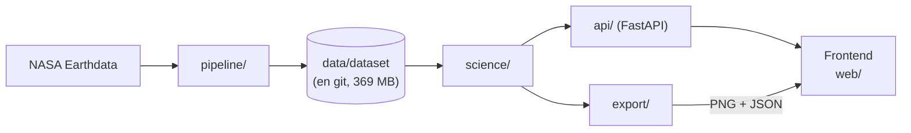

# RK_Vanguard_EarthScopeAI-BACK — Backend de EarthScope AI

**Equipo RoboKids · NASA Space Apps Challenge 2026 · "Be an Earth System Trend Detective"**

Este repo tiene la **ciencia, los datos NASA y la API** de EarthScope AI.
La web (Next.js) y la documentación del proyecto están en el **Frontend**: [junher30/RK_Vanguard_EarthScopeAI](https://github.com/junher30/RK_Vanguard_EarthScopeAI).



## Qué hay

| Carpeta | Qué hace |
|---|---|
| `science/` | **Única fuente de verdad científica**: tendencias (Mann-Kendall estacional, Sen, OLS AR(1)), What-If, tendencias por celda, análisis de cualquier área, lector del dataset |
| `api/` | FastAPI: `POST /api/v1/area/analyze` (cualquier polígono o punto del planeta), `GET /health`, `GET /variables`. Ver [docs/API.md](docs/API.md) |
| `data/dataset/` | **Dataset global completo** 2001–2024, 0,5°, 8 variables, comprimido (369 MB). **Viene al clonar.** Ver [docs/DATASET.md](docs/DATASET.md) |
| `data/sample/` | Muestra de 2° (27 MB) para desarrollo rápido y CI |
| `data/grids/`, `data/processed/` | Caso de estudio Amazonía central a 0,1° |
| `pipeline/` | Descarga NASA (`fetch_nasa.py`, `fetch_global.py`), empaquetado (`pack_dataset.py`) y muestra (`make_sample.py`) |
| `export/` | Genera las capas PNG y los JSON que muestra la web (los escribe en el repo Frontend) |
| `app/` | App Streamlit de análisis (respaldo) |
| `tests/` | Validación con datos sintéticos, el contrato de la API y la integridad del dataset |
| `docs/` | [DATASET.md](docs/DATASET.md), [API.md](docs/API.md), [DATOS_GLOBALES.md](docs/DATOS_GLOBALES.md) (métodos y resultados) |

## Inicio rápido

```bash
git clone https://github.com/jose6668/RK_Vanguard_EarthScopeAI-BACK.git   # trae el dataset completo (~400 MB)
cd RK_Vanguard_EarthScopeAI-BACK
python3 -m venv .venv && source .venv/bin/activate
pip install -r requirements-backend.txt          # liviano: API, ciencia y pruebas
uvicorn api.main:app --reload --port 8000        # http://localhost:8000/docs
```

- La primera consulta de cada variable decodifica el dataset a `data/.cache/` (unos segundos); después responde en menos de 1 s.
- Para descargar datos nuevos de NASA instala `requirements.txt` completo (incluye earthaccess, h5py y pyhdf) y configura Earthdata Login (ver [docs/DATASET.md](docs/DATASET.md)).

### Trabajar junto al Frontend
Clona los dos repos uno al lado del otro:
```
Documents/
├── RK_Vanguard_EarthScopeAI/        Frontend (web/ + docs/)
└── RK_Vanguard_EarthScopeAI-BACK/   este repo
```
- La web llama a la API en `http://localhost:8000` (o en `NEXT_PUBLIC_API_URL`).
- `python export/build_global_data.py` y `python export/build_site_data.py` escriben solos en `../RK_Vanguard_EarthScopeAI/web/public/data/`. Para otra ruta, usa `EARTHSCOPE_WEB_DATA=/ruta`.

### Datos que usa la API (`EARTHSCOPE_DATA`)
| Valor | Fuente |
|---|---|
| `auto` (por defecto) | Dataset completo `data/dataset/` (0,5°) |
| `full` | Siempre el dataset completo |
| `sample` | Muestra de 2° (rápida; resultados solo para desarrollo) |

## Pruebas
```bash
export EARTHSCOPE_DATA=sample
python tests/test_trends.py && python tests/test_whatif.py && python tests/test_global_trends.py
python tests/test_area.py && python tests/test_api.py
EARTHSCOPE_DATA=full python tests/test_dataset.py
```
GitHub Actions las corre en cada PR (`.github/workflows/ci.yml`).

## Cómo trabajamos
- Ramas y PR: [CONTRIBUTING.md](CONTRIBUTING.md). Se trabaja desde `Develop`; `main` es la versión estable.
- Historias de usuario: [rúbrica](https://github.com/junher30/RK_Vanguard_EarthScopeAI/blob/main/docs/gestion/RUBRICA_HISTORIAS_DE_USUARIO.md) y [backlog](https://github.com/junher30/RK_Vanguard_EarthScopeAI/blob/main/docs/gestion/BACKLOG_HU.md), compartidos por los 2 repos.

## Fuentes NASA
| Variable | Producto | DOI |
|---|---|---|
| Precipitación | GPM IMERG Final Monthly V07 | [10.5067/GPM/IMERG/3B-MONTH/07](https://doi.org/10.5067/GPM/IMERG/3B-MONTH/07) |
| Vegetación (EVI/NDVI) | MODIS/Terra MOD13C2 v6.1 | [10.5067/MODIS/MOD13C2.061](https://doi.org/10.5067/MODIS/MOD13C2.061) |
| Temperatura de superficie (día/noche) | MODIS/Terra MOD11C3 v6.1 | [10.5067/MODIS/MOD11C3.061](https://doi.org/10.5067/MODIS/MOD11C3.061) |
| Temperatura del aire, humedad específica y relativa (reanálisis) | MERRA-2 M2TMNXSLV v5.12.4 | [10.5067/AP1B0BA5PD2K](https://doi.org/10.5067/AP1B0BA5PD2K) |

Uso de IA: se usó un asistente de IA (Claude, de Anthropic) para asesoría técnica, código y documentación.
