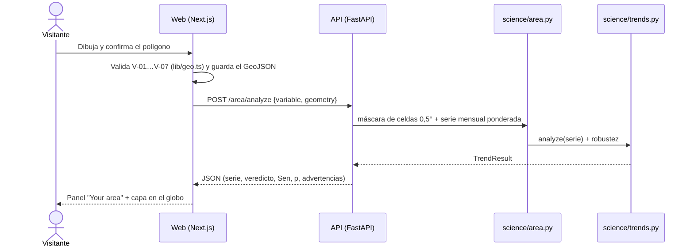

# API de análisis — EarthScope AI

```bash
uvicorn api.main:app --reload --port 8000      # documentación interactiva: http://localhost:8000/docs
```

## Endpoints

| Método | Ruta | Cuerpo / parámetros | Respuesta |
|---|---|---|---|
| GET | `/api/v1/health` | — | Meses disponibles por variable |
| GET | `/api/v1/variables` | — | Catálogo `GLOBAL_VARIABLES` |
| POST | `/api/v1/area/analyze` | `{variable, geometry?: GeoJSON Polygon, point?: {lat,lng}, alpha?}` | Serie, tendencia, robustez y advertencias, o `{ok:false, reason}` |
| GET | `/api/v1/forecast` | — | Años y variables de la proyección de la red neuronal; `status: "experimental"`, advertencia y horizonte validado (1 mes) |
| GET | `/api/v1/forecast/map/{var}/{year}.png` | `min`, `max` (escala de la web) | Mapa anual proyectado; más transparente donde el ensemble duda más |
| GET | `/api/v1/forecast/point/{var}` | `lat`, `lng` | Proyección anual en un punto, con dispersión del ensemble y advertencia |
| GET | `/api/v1/events` | — | Eventos naturales activos (NASA EONET: incendios, tormentas, volcanes…), caché de 30 min |
| GET | `/api/v1/satellites` | — | TLE de satélites (ISS, Terra, Aqua…) desde CelesTrak, caché de 6 h |
| POST | `/api/v1/agent/chat` | `{message, session, context?}` | Respuesta del agente y `actions` que la web ejecuta en el globo. 503 sin `requirements-agent.txt` o sin API key |
| GET | `/api/v1/simulate/models` | — | Modelos de escenario ("¿y si…?") con su validación fuera de muestra y `status` (`validated` / `no_skill`) |
| POST | `/api/v1/simulate` | `{model, inputs}` | Escenario `data_kind: "scenario"` con estimación, intervalo 95 %, alerta de extrapolación y supuestos. 404 modelo desconocido, 409 sin habilidad, 422 entrada fuera de rango. Ver `SIMULACIONES.md` |
| POST | `/api/v1/agent/voice` | audio WAV en el cuerpo, `session`, `context` | Transcripción + respuesta del agente |

**Proyección 2025-2030 (red neuronal):** es **experimental**. Está validada solo a 1 mes vista, no tiene validación por horizonte ni escenario de emisiones, y tiende a la climatología. La API y el agente lo declaran siempre. Pendiente: evaluar la habilidad por horizonte (1–12 meses) en `model/train_nn.py` antes de presentarla como pronóstico.

**Agente:** usa la ciencia del backend como herramientas (no inventa cifras de lugares). Necesita `ANTHROPIC_API_KEY` (u otro proveedor) en `.env`, que **no** se sube a git.

Documentación interactiva en `http://localhost:8000/docs`. CORS abierto (datos públicos, sin credenciales).

**Datos que usa** (`EARTHSCOPE_DATA`): `full` (0,5°, `data/dataset/`, en git), `sample` (2°, `data/sample/`, en git) o `auto` (el completo; la muestra solo si faltara). Cada respuesta indica `area.source` y `area.grid`.

## Flujo de una consulta de área




## Contrato con el Frontend
El Frontend lee la respuesta en `web/lib/api.ts` y `web/components/data/InsightPanel.tsx`. `tests/test_api.py` fija los campos obligatorios. Si cambian, hay que coordinar los PR de los dos repos (ver [CONTRIBUTING.md](../CONTRIBUTING.md)).

## Despliegue (pendiente, HU-09)
- Render o Hugging Face Spaces: `uvicorn api.main:app --host 0.0.0.0 --port $PORT`.
- El dataset viene con el repo. En el primer arranque se decodifica a `data/.cache/` (≈ 1,9 GB de disco temporal); si el plan gratuito no alcanza, usar `EARTHSCOPE_DATA=sample` solo como demostración, avisando.
- En el Frontend (Vercel), configurar `NEXT_PUBLIC_API_URL` con la URL pública.
