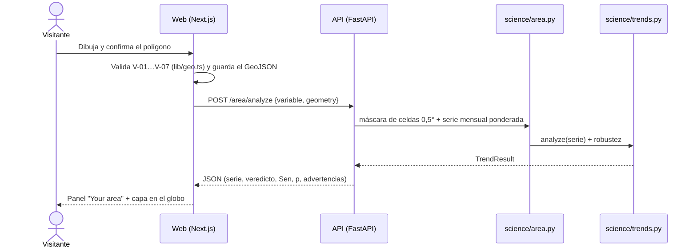

# API de análisis — EarthScope AI

```bash
uvicorn api.main:app --reload --port 8000      # documentación interactiva: http://localhost:8000/docs
```

## Endpoints

| Método | Ruta | Cuerpo / parámetros | Respuesta |
|---|---|---|---|
| GET | `/api/v1/health` | — | Meses disponibles por variable |
| GET | `/api/v1/variables` | — | Catálogo `GLOBAL_VARIABLES` |
| POST | `/api/v1/area/analyze` | `{variable, geometry?: GeoJSON Polygon, point?: {lat,lng}, alpha?}` | Serie, tendencia, robustez y advertencias, o `{ok:false, reason}` |

Documentación interactiva en `http://localhost:8000/docs`. CORS abierto (datos públicos, sin credenciales).

**Datos que usa** (`EARTHSCOPE_DATA`): `full` (0,5°, `data/dataset/`, en git), `sample` (2°, `data/sample/`, en git) o `auto` (el completo; la muestra solo si faltara). Cada respuesta indica `area.source` y `area.grid`.

## Flujo de una consulta de área




## Contrato con el Frontend
El Frontend lee la respuesta en `web/lib/api.ts` y `web/components/data/InsightPanel.tsx`. `tests/test_api.py` fija los campos obligatorios. Si cambian, hay que coordinar los PR de los dos repos (ver [CONTRIBUTING.md](../CONTRIBUTING.md)).

## Despliegue (pendiente, HU-09)
- Render o Hugging Face Spaces: `uvicorn api.main:app --host 0.0.0.0 --port $PORT`.
- El dataset viene con el repo. En el primer arranque se decodifica a `data/.cache/` (≈ 1,9 GB de disco temporal); si el plan gratuito no alcanza, usar `EARTHSCOPE_DATA=sample` solo como demostración, avisando.
- En el Frontend (Vercel), configurar `NEXT_PUBLIC_API_URL` con la URL pública.
